  

### `~ $ tail -f svtr/funding.log`

> Biggest AI rounds of the past 7 days, verified by the [SVTR AI Venture Database](https://svtr.ai) — the data I build tools on. Refreshed daily by a GitHub Action.

<!-- FUNDING:START -->
| Date | Company | Sector | Round | Amount | Lead |
|---|---|---|---|---:|---|
| 10-26 | **Bedrock Robotics** | Mobility & Logistics | Series C | $600M | CapitalG + |
| 10-26 | **趋境科技** | Optimization & Evals | Series B | $181M | 浙财资本 + |
| 10-27 | **General Compute** | Compute | Series A | $100M | Blackbird Ventures + |
| 10-26 | **Nevis** | Fintech | Series B | $70M | EQT Ventures |
| 10-27 | **Hyphenate** | Enterprise | Series A | $45M | Nexus Venture Partners |
<!-- FUNDING:END -->

→ full stream at [svtr.ai/stream](https://svtr.ai/stream?lang=en)

### `~ $ ls ~/projects --sort=impact`

| | Project | What it does |
|---|---|---|
| 🤖 | [**BP-Parser-for-SVTR**](https://github.com/ezshrimps/BP-Parser-for-SVTR) | Drop in a pitch deck (PDF / image / docx / URL) → structured deal record in the database |
| 🎌 | [**Japanese-Songs-Lyrics-Parser**](https://github.com/ezshrimps/Japanese-Songs-Lyrics-Parser) | Learn Japanese from songs: furigana, romaji, translation, grammar breakdown |
| 📱 | [**ShrimpLyricsParser**](https://github.com/ezshrimps/ShrimpLyricsParser) + [backend](https://github.com/ezshrimps/ShrimpWxBackend) | The lyrics parser as a WeChat mini-program, on a Next.js backend |
| 🍗 | [**ShrimpDiet**](https://github.com/ezshrimps/ShrimpDiet) | Snap your meal, a VLM counts the calories. Built because I'm trying to bulk |
| 🎨 | [**AI-Image-Gen-Arena**](https://github.com/ezshrimps/AI-Image-Gen-Arena-with-Replicate) | Blind side-by-side battles between image models on Replicate |

### `~ $ git log --author=me --oneline -5`

<!-- ACTIVITY:START -->
- `2026-05-04` [BP-Parser-for-SVTR](https://github.com/ezshrimps/BP-Parser-for-SVTR)
- `2026-04-13` [ShrimpDiet](https://github.com/ezshrimps/ShrimpDiet)
- `2026-03-21` [AI-Image-Gen-Arena-with-Replicate](https://github.com/ezshrimps/AI-Image-Gen-Arena-with-Replicate)
- `2026-03-19` [ShrimpLyricsParser](https://github.com/ezshrimps/ShrimpLyricsParser)
- `2026-03-19` [ShrimpWxBackend](https://github.com/ezshrimps/ShrimpWxBackend)
<!-- ACTIVITY:END -->

<code>~ $ cat ~/.hobbies</code>

 

🎵 **Rhythm games**: maimai main. I built [Maidle](https://github.com/ezshrimps/Maidle) (Wordle for maimai songs), a [mosaic song-guessing game](https://github.com/ezshrimps/maimai-songs-mosaic-guessing), and a [toolbar](https://github.com/ezshrimps/maimai-toolbar) for score grinding 
🏓 **Pickleball**: [toooo funnnnn](https://github.com/ezshrimps/PickleBallScoringRules) 
🦐 **Why shrimp?** It's in the username. Every side project gets a `Shrimp` prefix.

---

  
  
   
<!-- UPDATED:START -->
last sync: 2026-10-28 06:41 UTC
<!-- UPDATED:END -->

