<b>在 SVTR 做 AI 创投数据，下班做给自己用的小工具：学日语、记账、增肌、打音游。下面每个作品都是这样一点点长出来的。</b> 
<b>I build AI venture data tools at SVTR, and small tools for my own life after hours: learning Japanese, budgeting, bulking, rhythm games. Every project below grew out of that.</b>

   

## 🤖 BP-Parser-for-SVTR

<b>一份 BP 丢进来，一条投资记录走出去。</b>PDF 或一段文字都行，Claude 读完后把公司、赛道、轮次、金额、创始人拆成字段，一键填进 SVTR 的飞书创投库。人只需要最后看一眼。 
<b>Drop in a pitch deck, get a deal record out.</b> PDF or plain text: Claude reads it, splits out company, sector, round, amount and founders, and fills them into SVTR's Feishu venture database. A human just takes the last look.

## 🎌 Japanese Lyrics Parser

<b>每一句歌词，都是一堂日语课。</b>贴进一整首日文歌，每个汉字上标好平假名，整句给出罗马音和中文翻译，再把语法一个词一个词拆开。灵感来自 B 站 UP 主卷心儿。网页版之外，还有一个微信小程序版本「虾学日语歌」。 
<b>Every lyric is a Japanese lesson.</b> Paste a whole song: every kanji gets its furigana, every line gets romaji and a translation, and the grammar is broken down word by word. There's a web app and a WeChat mini-program.

## 🪐 personal-little-planet

<b>一座可以走进去的漂浮小镇。</b>我的个人说明书不是一页简历，而是一座 Three.js 小镇：九个可以推门进去的室内场景，收着我的爱好、藏品和旅行地图，还有我的摄影作品。还在慢慢盖。 
<b>A personal manual you can walk into.</b> Not a résumé page but a floating Three.js town: nine interiors to step into, holding my hobbies, collections, travel map and photography. Still under construction.

## 💸 ShrimpTransactions

<b>把每一笔钱，堆成看得见的柱子。</b>虾米记账本用 D3 把每月开销画成堆叠柱，颜色随金额从绿变红；直接拖、点、右键就能改账，能导入 CSV、设预算，Supabase 云同步，Ctrl+Z 随时反悔。 
<b>Every expense, stacked into bars you can see.</b> A D3 stacked-bar ledger where colour runs green to red with the amount. Drag, click or right-click to edit, import CSV, set budgets, sync through Supabase, and undo anytime.

## 🍗 ShrimpDiet

<b>拍一张饭，算出离增肌还差多少。</b>拍照或写一句话描述这顿饭，视觉模型认出里面的食物，估算热量和蛋白质；一天提醒三次，按每日目标算出今天还差多少。主要是做给自己的，我想增肌！ 
<b>Snap your meal, see how far you are from bulking.</b> Take a photo or describe what you ate; a vision model recognises the food and estimates calories and protein. Three reminders a day keep the count honest against your daily goal. Built for me, because I'm trying to bulk.

## 🎨 AI Image Gen Arena

<b>同一句提示词，让模型们盲选对决。</b>在 Replicate 上把几个生图模型放进同一个擂台，藏起名字只看图投票，看看谁才是真的好。 
<b>One prompt, blind battles between image models.</b> Several Replicate image models enter the same arena with their names hidden. You vote on the picture alone and see who really wins.

## 💡 ShrimpTRIZ

<b>卡住的问题，交给 40 条发明原理。</b>受 AutoTRIZ 论文启发：说出你想改进什么、又怕牺牲什么，它帮你理清背后的技术矛盾，再从 40 条发明原理里挑出值得一试的方向。 
<b>Stuck? Let 40 inventive principles have a go.</b> Inspired by AutoTRIZ: describe what you want to improve and what you're afraid to lose, and it untangles the contradiction underneath and picks principles worth trying.

## 🎵 maimai toolkit

<b>音游玩家的工具箱：猜歌、算分、上分。</b>舞萌 DX 玩家的一点私心：像 Wordle 一样按版本、等级、谱师、BPM 猜歌的 Maidle，打上马赛克猜曲绘，还有帮你上分的算分器和工具栏。 
<b>A rhythm gamer's toolkit: guess, calculate, climb.</b> For fellow maimai DX players: Maidle, a Wordle-style song guesser by version, level, charter and BPM; a mosaic jacket-art quiz; and a score calculator and toolbar for the grind.

## 📦 更多作品 · More

| | 作品 | 一句话 |
|---|---|---|
| 📱 | **SVTR-MiniProgram** 🔒 | SVTR AI 创投库的微信小程序，按公司、赛道、机构、人物、毕业学校查数据 · SVTR's venture database as a WeChat mini-program |
| 📒 | [**attention-is-all-i-read**](https://github.com/ezshrimps/attention-is-all-i-read) | 我的研究日志和方法论 · My research log and methods |
| 🍎 | [**Shrimp-Accounting**](https://github.com/ezshrimps/Shrimp-Accounting) | 记录每日收支的 iOS App，记账本的前身 · An iOS app for daily finances, ShrimpTransactions' ancestor |
| 🌐 | [**Personal-Website**](https://github.com/ezshrimps/Personal-Website) | [ezshrimps.com](https://ezshrimps.com)：编程、摄影、音游和匹克球 · Code, photography, rhythm games and pickleball |
| 🧩 | [**huggingface-based-AI-generate-similar-icon**](https://github.com/ezshrimps/huggingface-based-AI-generate-similar-icon) | 用 Hugging Face 模型生成风格相近的图标 · Generate look-alike icons with Hugging Face models |
| 🖼️ | [**Artwork-from-CS116**](https://github.com/ezshrimps/Artwork-from-CS116) | 用 CS116 学到的视觉技术做出来的"人造照片" · Synthetic photos made with CS116 vision techniques |
| 🧪 | [**CS117_final_project**](https://github.com/ezshrimps/CS117_final_project) | UCI CS117 课程期末项目 · Course final project |
| 🏓 | [**PickleBallScoringRules**](https://github.com/ezshrimps/PickleBallScoringRules) | 匹克球计分规则，太好玩了！ · Pickleball is toooo funnnnn |

**🤝 开源贡献 · Contributions**：给 [RealtimeTTS](https://github.com/ezshrimps/RealtimeTTS) 修了 `text_to_stream.py` 的一个 bug；在 [iDesignGPT](https://github.com/ezshrimps/VisualiDesignGPT) 的框架下加了一个可视化模块。

## 📡 `tail -f svtr/funding.log`

> 过去 7 天最大的 AI 融资，数据来自 [SVTR AI 创投库](https://svtr.ai)，也是我做工具时用的数据。GitHub Action 每天自动刷新。 
> Biggest AI rounds of the past 7 days, verified by the [SVTR AI Venture Database](https://svtr.ai). Refreshed daily by a GitHub Action.

<!-- FUNDING:START -->
| Date | Company | Sector | Round | Amount | Lead |
|---|---|---|---|---:|---|
| 10-30 | **Fractile** | Compute | Series C | $774M | 红点创投 + |
| 11-02 | **芯联动力** | Compute | Series C | $278M | 中国移动 |
| 11-03 | **墨芯科技** | Compute | Series C | $139M | — |
| 11-02 | **简智新创机器人科技** | Data | Series A | $100M | — |
| 11-02 | **Tutor Intelligence** | Robotics | Series B | $75M | Andreessen Horowitz |
<!-- FUNDING:END -->

→ full stream at [svtr.ai/stream](https://svtr.ai/stream?lang=en)

<b>🕒 最近在写 · Recently pushed</b>

 

<!-- ACTIVITY:START -->
- `2026-05-04` [BP-Parser-for-SVTR](https://github.com/ezshrimps/BP-Parser-for-SVTR)
- `2026-03-21` [AI-Image-Gen-Arena-with-Replicate](https://github.com/ezshrimps/AI-Image-Gen-Arena-with-Replicate)
- `2026-03-19` [ShrimpLyricsParser](https://github.com/ezshrimps/ShrimpLyricsParser)
- `2026-03-19` [ShrimpWxBackend](https://github.com/ezshrimps/ShrimpWxBackend)
- `2026-03-19` [Japanese-Songs-Lyrics-Parser](https://github.com/ezshrimps/Japanese-Songs-Lyrics-Parser)
<!-- ACTIVITY:END -->

<!-- UPDATED:START -->
last sync: 2026-11-03 18:14 UTC
<!-- UPDATED:END -->

