<b>在 SVTR 做 AI 创投数据，下班做给自己用的小工具：学日语、拆难题、给自己盖一座小镇。下面每个作品都是这样一点点长出来的。</b> 
<b>I build AI venture data tools at SVTR, and small tools for my own life after hours: learning Japanese, cracking stuck problems, building myself a little town. Every project below grew out of that.</b>

   

## 📡 funding.log

<b>每天早上，最大的 AI 融资自动送到这里。</b>这块直接接着我在 SVTR 做的 AI 创投库：GitHub Action 每天通过 [svtr.ai](https://svtr.ai) 的 MCP 接口，拉取过去 7 天金额最大的 5 笔 AI 融资，刷新到下面这张表。 
<b>The week's biggest AI rounds, delivered every morning.</b> This block reads straight from the SVTR AI Venture Database I work on: a daily GitHub Action pulls the five biggest AI rounds of the past 7 days through svtr.ai's MCP server and refreshes the table below.

<!-- FUNDING:START -->
| Date | Company | Sector | Round | Amount | Lead |
|---|---|---|---|---:|---|
| 11-05 | **Zipline** | Mobility & Logistics | — | $1.5B | Paradigm + |
| 11-05 | **Harbinger Motors** | Mobility & Logistics | Series D+ | $240M | Tiger Global + |
| 11-05 | **三呆科技** | Vertical Models | Series A | $200M | 基石资本 + |
| 11-05 | **T-Therapeutics** | Life Sciences | Series B | $133M | Advent Life Sciences + |
| 11-05 | **Ocient** | Data | Series C | $100M | BOKA Capital + |
<!-- FUNDING:END -->

→ full stream at [svtr.ai/stream](https://svtr.ai/stream?lang=en)

## 🗂️ izzy · daily

<b>一句话进来，全部归位。</b>我的个人每日面板只有一个输入框：「午饭牛肉面 18，4 点到 6 点健身，周五前交水电费」，Claude 会拆成饮食、花费、时间线和待办，各放各的位置，写错一键撤销。背后接着 Gmail 里的银行提醒、Google 日历和每天早上的 AI 早报，整个面板是一个跑在 Claude Artifact 上的 HTML 文件。 
<b>One sentence in, everything filed.</b> My daily dashboard has a single input box. Type "beef noodles $18, gym 4 to 6, pay the bill by Friday" and Claude splits it into a meal, an expense, a timeline slot and a to-do, each filed in the right place with one-tap undo. Bank alerts from Gmail, Google Calendar and a morning AI brief feed in automatically, all from one HTML file running as a Claude Artifact.

## ⛳ golf-course-vlog

<b>一场球的原片丢进来，一条整场 vlog 走出去。</b>打完一场球拍了 70 多段素材，我把剪辑全流程写成了一个 Claude Code skill：YOLO 姿态加击球声找出每一杆，OpenStreetMap 画出每洞地图，再叠上转播风格的 UI，包括洞号 HUD、挥杆轨迹、球路追踪，以及球速、飞行距离和节奏比的数据卡。另外还能剪满意球精华，或者配一首歌，按底鼓把每一杆的击球卡在拍上。 
<b>Raw round footage in, a full-course vlog out.</b> After a round with 70+ clips, I turned the whole edit into a Claude Code skill. YOLO pose plus impact-sound detection finds every shot, and OpenStreetMap draws each hole. On top goes a broadcast-style overlay: a hole HUD, swing tracer, ball tracking, and cards with ball speed, carry and tempo. It can also cut a best-shots reel, or sync every impact to the kick drum of a song.

## 🎌 Japanese Lyrics Parser

<b>每一句歌词，都是一堂日语课。</b>贴进一整首日文歌，每个汉字上标好平假名，整句给出罗马音和中文翻译，再把语法一个词一个词拆开。灵感来自 B 站 UP 主卷心儿。网页版之外，还有一个微信小程序版本「虾学日语歌」。 
<b>Every lyric is a Japanese lesson.</b> Paste a whole song: every kanji gets its furigana, every line gets romaji and a translation, and the grammar is broken down word by word. There's a web app and a WeChat mini-program.

## 💡 ShrimpTRIZ

<b>卡住的问题，交给 40 条发明原理。</b>受 AutoTRIZ 论文启发：说出你想改进什么、又怕牺牲什么，它帮你理清背后的技术矛盾，再从 40 条发明原理里挑出值得一试的方向。 
<b>Stuck? Let 40 inventive principles have a go.</b> Inspired by AutoTRIZ: describe what you want to improve and what you're afraid to lose, and it untangles the contradiction underneath and picks principles worth trying.

## 🪐 personal-little-planet

<b>一座可以走进去的漂浮小镇。</b>我的个人说明书不是一页简历，而是一座 Three.js 小镇：九个可以推门进去的室内场景，收着我的爱好、藏品和旅行地图，还有我的摄影作品。还在慢慢盖。 
<b>A personal manual you can walk into.</b> Not a résumé page but a floating Three.js town: nine interiors to step into, holding my hobbies, collections, travel map and photography. Still under construction.

## 📦 更多作品 · More

| | 作品 | 一句话 |
|---|---|---|
| 📱 | **SVTR-MiniProgram** 🔒 | SVTR AI 创投库的微信小程序，按公司、赛道、机构、人物、毕业学校查数据 · SVTR's venture database as a WeChat mini-program |
| 📒 | [**attention-is-all-i-read**](https://github.com/ezshrimps/attention-is-all-i-read) | 我的研究日志和方法论 · My research log and methods |
| 🍎 | [**Shrimp-Accounting**](https://github.com/ezshrimps/Shrimp-Accounting) | 记录每日收支的 iOS App · An iOS app for daily finances |
| 🌐 | [**Personal-Website**](https://github.com/ezshrimps/Personal-Website) | [ezshrimps.com](https://ezshrimps.com)：编程、摄影、音游和匹克球 · Code, photography, rhythm games and pickleball |
| 🧩 | [**huggingface-based-AI-generate-similar-icon**](https://github.com/ezshrimps/huggingface-based-AI-generate-similar-icon) | 用 Hugging Face 模型生成风格相近的图标 · Generate look-alike icons with Hugging Face models |
| 🖼️ | [**Artwork-from-CS116**](https://github.com/ezshrimps/Artwork-from-CS116) | 用 CS116 学到的视觉技术做出来的"人造照片" · Synthetic photos made with CS116 vision techniques |
| 🧪 | [**CS117_final_project**](https://github.com/ezshrimps/CS117_final_project) | UCI CS117 课程期末项目 · Course final project |
| 🏓 | [**PickleBallScoringRules**](https://github.com/ezshrimps/PickleBallScoringRules) | 匹克球计分规则，太好玩了！ · Pickleball is toooo funnnnn |

**🤝 开源贡献 · Contributions**：给 [RealtimeTTS](https://github.com/ezshrimps/RealtimeTTS) 修了 `text_to_stream.py` 的一个 bug；在 [iDesignGPT](https://github.com/ezshrimps/VisualiDesignGPT) 的框架下加了一个可视化模块。

<b>🕒 最近在写 · Recently pushed</b>

 

<!-- ACTIVITY:START -->
- `2026-11-06` [golf-course-vlog](https://github.com/ezshrimps/golf-course-vlog)
- `2026-11-05` [izzy-daily](https://github.com/ezshrimps/izzy-daily)
- `2026-03-21` [AI-Image-Gen-Arena-with-Replicate](https://github.com/ezshrimps/AI-Image-Gen-Arena-with-Replicate)
- `2026-03-19` [ShrimpLyricsParser](https://github.com/ezshrimps/ShrimpLyricsParser)
- `2026-03-19` [ShrimpWxBackend](https://github.com/ezshrimps/ShrimpWxBackend)
<!-- ACTIVITY:END -->

<!-- UPDATED:START -->
last sync: 2026-11-06 21:21 UTC
<!-- UPDATED:END -->

